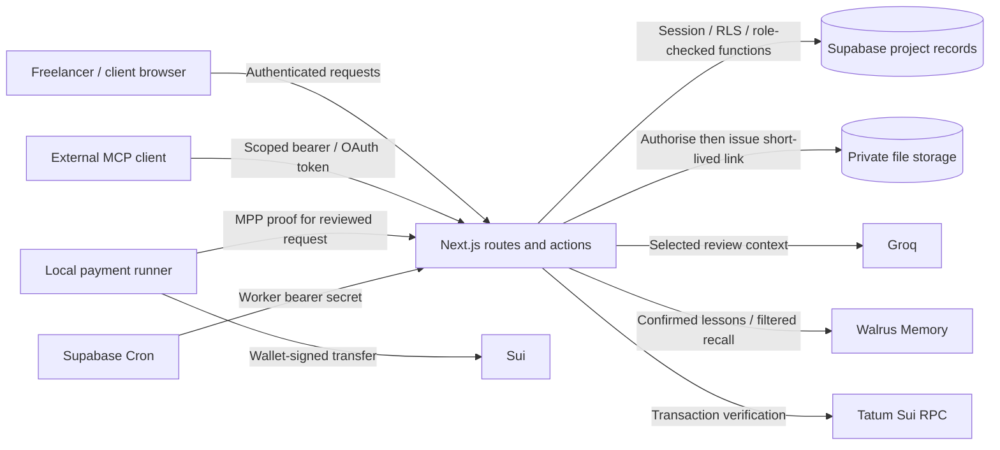

# Parius threat model

Reviewed: **30 October 2026**. This describes the current application boundaries and the evidence supporting them. It is a maintainer review, not an independent audit or a guarantee that no vulnerabilities exist.

The model follows [OWASP's threat-modeling approach](https://cheatsheetseries.owasp.org/cheatsheets/Threat_Modeling_Cheat_Sheet.html): describe the system, identify what could go wrong, map controls to threats, and validate them. STRIDE provides the threat categories below. The [security testing guide](docs/SECURITY_TESTING.md) explains how to challenge these controls. Separate dated reports record the [local baseline](docs/evidence/security/2026-10-30.md), [controlled live exercise](docs/evidence/security/2026-10-30-live.md) [local request-body hardening](docs/evidence/security/2026-10-30-hardening.md) and the [adversarial source/database review](docs/evidence/security/2026-10-30-adversarial-review.md), which found and fixed five issues.

## What needs protection

Parius connects two people around an approved agreement, delivery and payment. The valuable assets are their project records, private lessons and AI drafts, unreleased files, wallet ownership proofs, payment instructions and ledger, and short-lived agent access. Server credentials and the local payment runner's wallet key protect privileged capabilities.

An attacker may be an unauthenticated visitor, a signed-in outsider, a legitimate client or freelancer trying to exceed their role, someone with a stolen agent key, or a source of malicious project text, files or provider responses. A malicious browser extension, compromised provider, stolen session or compromised application operator is also relevant, but application permissions alone cannot contain all of those cases.

## Data flows and trust boundaries

1. **Browser → server:** IDs, amounts, roles, quotations and claimed payment success are untrusted inputs. Normal workspace operations use the authenticated session and database permissions.
2. **Server → privileged database/storage operations:** the service-role credential bypasses ordinary RLS. Its server-only callers must first establish the exact authorised project, actor, request or worker lease. Keeping it out of the browser is necessary but does not itself make every privileged call safe.
3. **Application → providers:** selected project text and recalled lessons are processed by the AI provider; confirmed lessons are submitted to Walrus Memory. Provider availability and returned content are not trusted as authority to approve, pay or release. Project namespaces are application isolation, not a claim of user-held end-to-end encryption from the operator.
4. **Wallet → chain → ledger:** a signature authorises a specific transaction. A transaction ID, chat claim or HTTP success does not establish invoice payment. The configured network and asset, sender, recipient, amount, outcome and timing must match before reconciliation.
5. **External assistant → project:** the one-hour connection authorises bounded project reads. Payment delegation is separate and bound to one reviewed request. Neither grants agreement changes, private-memory access, reconciliation or file release.
6. **Scheduler → worker:** a server secret and database leases protect background completion and storage cleanup. Providers, deployment credentials and the hosting configuration remain trusted operational dependencies.

Relevant implementations: [architecture](docs/ARCHITECTURE.md), [privileged client](src/lib/server/privileged.ts), [agent dispatcher](src/features/agents/server/access.ts), [file download route](src/app/api/files/[id]/route.ts), [memory adapter](src/features/memory/server/provider.ts), and [worker route](src/app/api/internal/jobs/route.ts).

## Security rules that must remain true

- Changing an ID never grants another project's data or actions. Clients cannot read the freelancer's private scope reviews, lessons, follow-up drafts or unissued invoice drafts.
- Both participants approve the same agreement version. A freelancer cannot impersonate client acceptance; stale approvals do not silently replace current terms.
- AI output is advisory. It cannot approve terms, send an unreviewed reply, sign a payment, reconcile a receipt or release a final. Valid source quotations do not guarantee that every explanation is correct.
- Payment amounts use integer atomic units. Wrong-network, wrong-asset, wrong-recipient, wrong-sender, failed or replayed evidence must not earn an invoice credit. Retrying a saved request must not initiate another transfer or duplicate its credit.
- Manual receipts remain explicitly manual. A reconciled balance may include human-entered receipts; a paid invoice is not automatically proof that every payment was verified on chain.
- An OAuth project-read token cannot become a payment token. Expired/revoked access and lost project membership must fail on a new tool call.
- Final-file downloads require current membership and the applicable release conditions, including explicit freelancer release. An already-issued signed URL can remain usable for its short lifetime.
- A memory enters recall only when confirmed, ready and matched to an authorised stored reference. Excluded/deletion-requested lessons are not eligible; remote erasure must not be claimed before it happens.

## Threats, controls and evidence

The categories are **S**poofing, **T**ampering, **R**epudiation, **I**nformation disclosure, **D**enial of service and **E**levation of privilege. Priorities describe the consequence if a boundary fails, not a quantified probability or a claim of a discovered exploit. “Offline passed” refers to the dated report, not hosted acceptance.

| ID | Threat / consequence | Current control and automated evidence | Remaining limit |
| --- | --- | --- | --- |
| TM-01 · S/I/E · High | Outsider or participant substitutes project, invoice or review IDs. | Session checks, RLS and role-checked SQL; [database](tests/database.test.ts), [history](tests/history.test.ts), [learning/payment](tests/learning-payments.test.ts) tests: offline passed. [Hardening](tests/supabase-hardening.test.ts) applies every migration under Supabase's default grants and asserts no anonymous function, no client-writable table and no table without RLS. | Repeat through actual hosted HTTP and authenticated Supabase sessions; the SQL harness simulates identity. |
| TM-02 · T/R/E · High | One party changes agreed terms or accepts their own delivery. | Version approvals, stale-base checks and separate client acceptance; [agreement lifecycle](tests/agreement-lifecycle.test.ts), [database](tests/database.test.ts): offline passed. | Human approval does not establish legal enforceability or prevent collusion. |
| TM-03 · S/T/E · High | Forged wallet ownership, altered transaction bytes or sponsor response redirects payment. | Domain/network/nonce/lifetime-bound wallet proof; reviewed bytes, signature intent and sponsor checks; [wallets](tests/wallets.test.ts), [checkout](tests/checkout.test.ts): offline passed. | A compromised wallet, endpoint device or trusted provider remains outside those checks. |
| TM-04 · T/R/E · High | Reused or mismatched transfer produces false or duplicate credit. | Exact matching, immutable reviewed instructions, receipt reservations and reconciliation rules. One transfer can match only one payment request, including under concurrent verification; definitive mismatches are rejected on both browser and agent paths. [learning/payments](tests/learning-payments.test.ts), [agents](tests/agents.test.ts), [hardening](tests/supabase-hardening.test.ts): offline passed. | Funded evidence is Testnet; parallel HTTP/database race behaviour still needs a separate staging exercise. |
| TM-05 · S/I/E · High | Stolen, expired or revoked agent key exposes data or exceeds its project/payment bounds. | Hashed manual keys, one-hour expiry, current access checks, bounded context and request-specific delegation; [agents](tests/agents.test.ts), [invoice summary](tests/agent-invoice-summary.test.ts): offline passed. | A stolen valid bearer key can exercise its existing scope until expiry/revocation. Prompt instructions cannot revoke it. |
| TM-06 · S/T/I/E · High | OAuth code/token theft, callback substitution, replay or audience confusion. | Exact registered callback, S256 PKCE, resource/scope binding, encrypted token envelopes and private, single-use short-lived codes; [OAuth](tests/agent-oauth.test.ts): offline passed. | Official SDK tests are not acceptance by every real vendor. Signing/encryption material currently derives from the service-role secret; rotation has a shared blast radius. |
| TM-07 · I/E · High | Client downloads a locked final, guesses a storage path or keeps access after reversal. | Reserved private uploads, restrictive storage policies, current release/ledger gates, 60-second signed downloads; [files](tests/files.test.ts): offline passed, including a fixture with unrelated broad storage policies. | Previously issued links survive up to 60 seconds. Downloaded copies cannot be recalled. Content checks are not antivirus or ZIP-content scanning. |
| TM-08 · T/I/E · High | Forged recall or malicious project text injects instructions or leaks private lessons. | Owner/project namespaces, ready-reference filtering, checked quotation/citation provenance, role privacy and human action boundaries; [scope](tests/scope-review.test.ts), [memory transparency](tests/memory-transparency.test.ts), [learning/payments](tests/learning-payments.test.ts): offline passed. | Free-form model interpretation can still be wrong. Comprehensive prompt-injection resistance and privacy against the operator/provider are not established. |
| TM-09 · S/T/D/E · High | Caller invokes worker cleanup/completion or replays a stale lease. | Timing-safe worker secret check, service-only functions, bounded claims, recoverable leases and retries; [worker](tests/worker.test.ts): offline passed. | A leaked worker/service secret or misconfigured hosting invalidates these assumptions; production job success alone does not test rejection. |
| TM-10 · T/R · Medium | Edits, manual credits or duplicate sends leave a misleading history. | Preserved reversal records, exact totals, stale-draft checks and idempotent sends; [follow-ups](tests/followups.test.ts), [history](tests/history.test.ts), [invoice summary](tests/agent-invoice-summary.test.ts): offline passed. | Application history is not an independently signed or externally immutable audit log. |
| TM-11 · D · Medium | Authenticated abuse, large/chunked bodies or upstream failure consumes memory, provider spend or worker capacity. | Per-account database budgets on every free-text or unbounded write (messages, projects, agreements, milestones, invites, payment requests) alongside existing quotas; a per-account cap on the shared gas-sponsorship pool; bounded OAuth/MCP bodies; bounded batches, output limits, deadlines and retry classification. [Hardening](tests/supabase-hardening.test.ts), [request body](tests/request-body.test.ts), [worker](tests/worker.test.ts), [memory retry](tests/memory-retry.test.ts), [scope](tests/scope-review.test.ts): offline passed. | Many sign-ups can still share out the sponsorship pool; wallet-paid gas always remains available. IP/platform rate limits and deployment-level load acceptance are not recorded. |
| TM-12 · S/T/I/E · High | Compromised dependency, CI credential, host, database administrator or provider bypasses application policy. | Server-only modules, locked dependency installation, restricted CI permissions and pinned action revisions in [CI](.github/workflows/ci.yml). | No independent supply-chain audit, secret-history scan, dependency-advisory clearance, disaster-recovery exercise or provider audit is claimed. |

## Follow-up priorities

The owner-authorised [30 October live exercise](docs/evidence/security/2026-10-30-live.md) passed 14 cases using disposable freelancer, client and outsider accounts. It covered a subset of access, role and revocation boundaries without funds or provider jobs. Before widening real-funds use, complete the remaining hosted scenarios, preferably in separate staging: signed-file gates, lost membership, real expiry, OAuth exchange/replay and duplicate receipt races. Record exact attempts and actual outcomes in the [testing guide's report format](docs/SECURITY_TESTING.md#record-each-attempt).

Apply [migration 202610300001](supabase/migrations/202610300001_abuse_limits.sql) to the hosted database and redeploy before describing the adversarial-review fixes as live; then repeat a small hosted smoke check (message, agreement, one Testnet payment preparation).

Local hardening now bounds OAuth registration/token and authenticated MCP request bytes and total read time, including absent/misleading Content-Length. Regression tests cover these inputs and valid official MCP traffic; deployment remains a separate step. Review explicit MCP Origin/Host policy and per-identity/request budgets. Existing quotas are useful but do not establish complete DoS protection. The live exercise confirmed selected HTTPS/cache/frame headers, not deployment cookie, CSP, firewall or comprehensive abuse settings.

Separate OAuth/payment signing material from the database service-role credential as a future hardening change, with an explicit migration/rotation plan. Review service-role and memory-delegate privileges and minimise their reach. Verify backups/restoration and revocation/rotation procedures. Track provider data exposure and remote-memory deletion handling accurately.

Run a dedicated dependency-advisory and secret-history review, then request independent review of the payment, OAuth, RLS and storage boundaries. Passing local tests and publishing this document do not replace those activities.

## Maintenance and disclosure

Update this model when a trust boundary changes: new provider, agent tool, payment method/network, release rule, identity flow, database permission or credential type. For each security fix, preserve a reproducer that fails before the fix, add a regression test and rerun the relevant positive and negative paths. Preserve applied migration history.

Test only systems and accounts for which the owner has explicitly authorised the exercise. Keep tokens, signed links, private messages, raw keys and personal data out of public evidence. Report suspected vulnerabilities privately to the maintainer; if GitHub private vulnerability reporting is enabled, use that channel. Do not post a live exploit or credentials in a public issue. No response-time commitment or independently audited status is implied.
