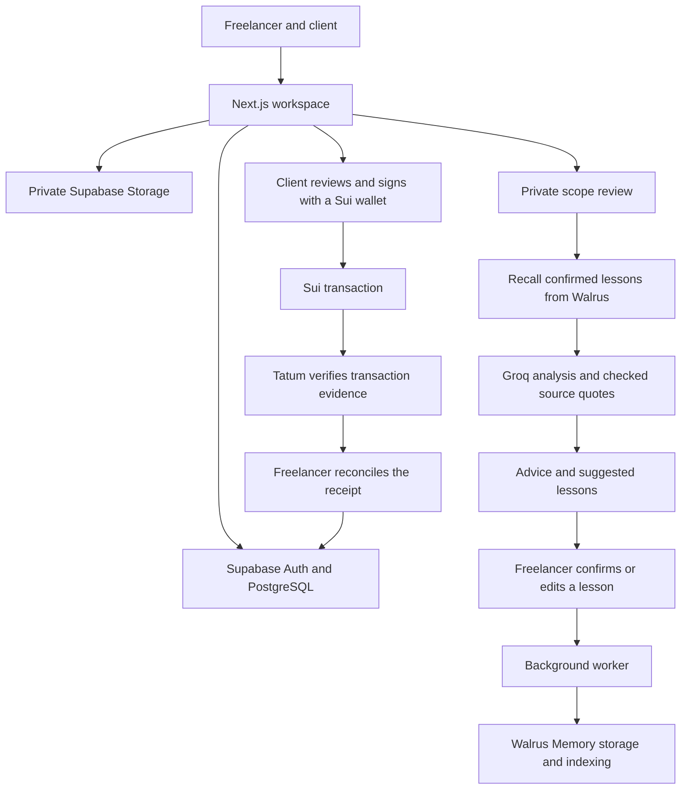

# Architecture

Parius is one Next.js application. Supabase holds the project facts, Walrus holds confirmed learned context, and Sui holds payment transactions. These have separate responsibilities.

## Shared records and private assistance

| Record                                                                    | Where it lives           | Who can use it                                                                   |
| ------------------------------------------------------------------------- | ------------------------ | -------------------------------------------------------------------------------- |
| Membership, messages, agreement versions, approvals and milestones        | Supabase PostgreSQL      | The project's participants, subject to action-specific permissions.              |
| Issued invoices, receipts and payment promises                            | Supabase PostgreSQL      | Both participants. Invoice drafts remain private to the freelancer.              |
| Scope reviews, suggested lessons, comparisons and unsent follow-up drafts | Supabase PostgreSQL      | The owning freelancer.                                                           |
| Confirmed lesson references and storage state                             | Supabase PostgreSQL      | The owning freelancer. Local records authorize which remote lessons may be used. |
| Confirmed lesson content                                                  | Walrus Memory via MemWal | Recalled through the server after identity, scope and status checks.             |
| File metadata and release conditions                                      | Supabase PostgreSQL      | Project members; download permission is checked separately.                      |
| File bytes                                                                | Private Supabase Storage | Downloaded using a short-lived signed link after server authorization.           |
| Transfers                                                                 | Sui                      | Public blockchain data. Signing is performed by the user's wallet.               |

Normal workspace access uses the authenticated Supabase session and row-level security. Server actions recheck identity and membership. Privileged credentials are used for narrowly defined provider completion and worker operations; they are never browser credentials.

Roles belong to a project. The same account can be a freelancer in one project and a client in another. A private lesson scoped to one project is not automatically shared with its client or used in another project.

## Agreement and delivery rules

The freelancer publishes an immutable proposal snapshot. Each approval belongs to that exact version. A replacement only becomes active after both participants approve; stale proposals cannot silently approve against a changed baseline. The client may reject a pending proposal and the freelancer may withdraw it. Active and previously active versions remain history.

Milestones move through **planned → in progress → ready for review → accepted**, with a **changes requested** path back to work. The freelancer submits; the client accepts or requests changes. Planning a milestone is separate from approving contractual terms.

For files, attachments and previews can be downloaded by both participants once verified. Final files require an accepted milestone, the selected agreement-backed release rule, and explicit freelancer release. An invoice-paid rule additionally checks full recorded payment of the linked invoice. Download authorization is checked again, so a reversed receipt or changed agreement can block a new download. An already downloaded copy cannot be recalled; an already issued storage URL can remain usable for up to 60 seconds.

The upload path checks membership, allowed type, size and file content before making the file ready. Removed or expired uploads are cleaned up through the worker. Ready files are not cleanup targets merely because time has passed.

## The learning loop

1. The freelancer requests a review for a specific message against the active agreement.
2. The server loads authorized source records and recalls relevant lessons through Walrus Memory.
3. Groq returns a structured classification, explanation and suggested reply. The application checks quoted agreement/request text and cited lesson IDs/text against supplied sources before recording the result.
4. A completed extra-work or clarification review can create a conservative suggested lesson. The current suggestion rules are templates based on those classifications, not a general conversation-mining agent.
5. The freelancer confirms, edits or dismisses the suggestion. Only confirmation creates a storage task. Repeated confirmation does not create duplicate lessons.
6. The worker submits the lesson and tracks the returned remote job. **Stored on Walrus** requires completed storage with a blob reference; confirmation alone is not sufficient.
7. Later reviews recall ready, authorized lessons. Project lessons stay in their project; explicitly selected general preferences can be used across that freelancer's projects.

MemWal namespaces are derived from the authenticated user and optional project ID. A namespace is not an authorization boundary by itself: Parius also filters recalled results against the user's eligible confirmed references and checks the active account/delegate configuration.

The **Why** view shows checked quotes and the model's explanation of relevance. It does not expose hidden model reasoning or prove causality. Paired comparison uses two independent calls with the same source context and settings, changing only historical lessons; it can produce similar results. If recall is unavailable, the comparison does not substitute local lesson text and claim it came from Walrus.

Lessons can be corrected or excluded. A permanent deletion request excludes and locally redacts the lesson immediately; remote deletion requires account-owner handling. The managed relayer processes lesson content, so this design does not claim that only the end user can ever read it. Store minimal confirmed lessons, not credentials or entire private conversations.

## The payment path

1. The freelancer drafts an invoice against the current approved total. The client cannot see a draft.
2. Issuing fixes the invoice details and, for Sui checkout, its receiving address, network and canonical USDC type.
3. The client verifies ownership of a sending wallet by signing a short-lived message bound to the user, address, origin, network and nonce. This is separate from signing a transfer.
4. The client reviews and confirms payment instructions, then explicitly approves wallet checkout. Checkout records preparation/submission so retries do not casually prepare and broadcast another transfer.
5. Tatum supplies transaction evidence. The application checks success, network, sender, recipient, token, amount and the request's time window. A wallet success screen or arbitrary digest does not count as settlement proof.
6. The freelancer explicitly allocates the verified receipt to the invoice. If the same payment was already recorded manually, the matching manual record must be replaced rather than counted twice.

Amounts are handled as integer atomic units. Visible history is paginated, but invoice balances use the full active receipt ledger. A promise never changes those balances. A manual receipt is an assertion that money was received elsewhere; it remains distinct from Tatum verification and can be reversed without sending a refund.

Enoki can provide a Google wallet and supported sponsorship. Installed wallets use Wallet Standard through dApp Kit. The SDK restores a previously authorized wallet connection after reload without signing a payment; disconnecting clears that connection preference. Saved ownership verification is a separate database record, and a wallet may need reconnecting even while that proof remains valid. Supabase authentication and wallet authentication are separate. Parius is not an escrow contract and does not hold funds for either participant.

## Private replies and follow-up drafts

Scope reviews return a suggested reply that the freelancer can place in the message composer and edit before sending. Invoice follow-ups are a separate flow: authoritative invoice and promise records supply the balance, dates and attribution; Groq assists the closing wording. The application does not ask the model to decide what is owed.

The freelancer prepares a private draft, saves edits and confirms the final text in a send dialog. The sent message appears under the freelancer's name in project chat. A client cannot read an unsent draft. Revision checks protect concurrent edits, changed financial facts block stale sending, and retrying an already-sent draft returns its original message. A labelled template remains available when AI wording fails. Neither flow sends an email or authorizes a payment.

## Background work and failure recovery

Supabase Cron calls `/api/internal/jobs` with a server-only bearer token. A local runner calls the same endpoint during development. Leases, bounded batches and retry delays limit duplicate work and recover interrupted runs. The worker handles memory storage/indexing and file cleanup; it cannot approve agreements, send follow-ups, release finals or authorize payments.

Provider failures remain visible. They do not rewrite agreements, mark invoices paid or pretend memory storage succeeded. Follow-up generation may use a labelled template when AI wording is unavailable; a human still reviews and sends it. Changed invoice/promise facts make an old draft stale, and sending the same saved draft twice returns the original message rather than posting a duplicate.

## Code map

| Path                           | Responsibility                                                                    |
| ------------------------------ | --------------------------------------------------------------------------------- |
| `src/app/`                     | Pages, authenticated actions, authentication callbacks and file/worker endpoints. |
| `src/components/`              | Workspace tabs, forms, custom selects, wallet and payment UI.                     |
| `src/lib/`                     | Domain rules, amounts, history, validation, evidence checks and wallet helpers.   |
| `src/lib/server/`              | Groq, MemWal, Tatum, checkout and privileged server adapters.                     |
| `src/lib/supabase/`            | Browser/server Supabase clients.                                                  |
| `supabase/migrations/`         | Database schema, action permissions, lifecycle functions and job controls.        |
| `supabase/worker_schedule.sql` | Deployment-only scheduler activation.                                             |
| `scripts/`                     | Font setup, worker runner and integration diagnostics.                            |
| `tests/`                       | Domain, provider-boundary and embedded PostgreSQL tests.                          |

Activity is a shared timeline of recorded project events, not an exhaustive view into private AI drafts, lessons or provider operations. Notifications and the optional agent payment handoff remain future work.

## Scoped agents and MPP payments

`/api/mcp` uses the official MCP SDK's stateless Streamable HTTP transport. A server-only dispatcher validates a hashed key, one project, current membership, expiry and revocation on every call. It returns bounded, selected project records. A client key cannot reveal an unissued freelancer invoice. The API exposes three read-only tools; payment authorization, signing and execution are separate from MCP reads.

A client can bind a connection to exactly one existing, reviewed payment request. `/api/agent/payment` emits an HTTP 402 MPP `sui/charge` challenge. Its HMAC binds the connection, request, payer, network, canonical asset, exact amount, recipient and expiry. The payer returns a standard `Authorization: Payment ...` credential, including a Sui personal-message proof bound to that challenge and transaction digest. The local runner uses suimpp to create this credential; the server uses the stricter existing Tatum receipt matcher for exact sender/recipient/amount/asset/window checks. It never substitutes a public-node read for Tatum verification.

Private PostgreSQL digest reservations are unique by network/digest and by connection. The existing receipt lease prevents concurrent verification, while a cached verified/credited claim returns the same result. A different digest on that connection is refused. Browser checkout preparation is blocked while that invoice has an active agent delegation. Provider failure remains retryable and preserves the attempted digest. The local runner additionally journals the signed transaction before broadcast, so a lost response does not require a new transfer.

This flow records a matched receipt; it does not bypass freelancer reconciliation or explicit file release. The endpoint does not broadcast a user's browser wallet or receive wallet private keys. The local payment runner supports Testnet only. Protocol interoperability tests simulate settlement, so their success is distinct from funded live acceptance. The Sui method adapter is the community `@suimpp/mpp` package; the transport and challenge/credential/receipt formats come from `mppx`.
